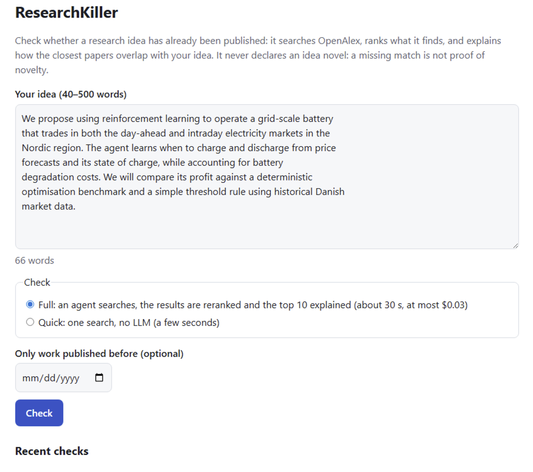
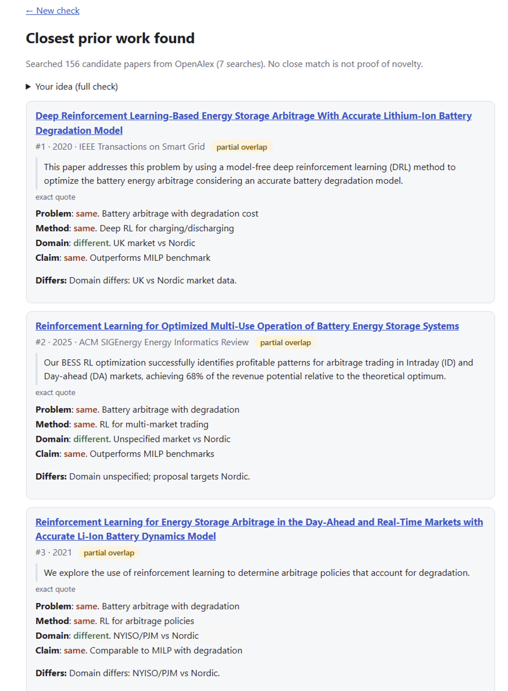
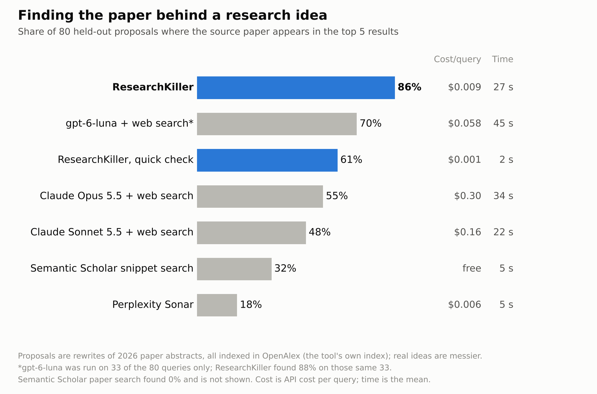

# ResearchKiller

ResearchKiller checks whether a research idea has already been published. You
describe your idea in 40 to 500 words; it searches OpenAlex, ranks what it finds
with an LLM, and shows the closest papers, each with an overlap rating, a sentence
from its abstract and what it does differently. It is for researchers and students
who want to see the closest published work before they invest in an idea. It runs on
your own machine with your own API keys, for about $0.016 a check. It never declares
an idea novel: a missing match is not proof of novelty.

Designed and evaluated by Charalampos Karatzas, built with Claude Code as the coding agent.





## Quick start

You need Python 3.10 or later, an OpenRouter API key, and preferably a free OpenAlex
API key.

```
git clone https://github.com/xariska3/researchkiller.git
cd researchkiller
python -m venv .venv
source .venv/bin/activate          # Windows: .venv\Scripts\activate
pip install -e ".[dense]"
cp .env.example .env               # Windows: copy .env.example .env
```

Put your keys in `.env`:
- `OPENROUTER_API_KEY` (required, paid): the LLM calls, to Qwen3 235B and Mistral
  Medium 3.1, go through [OpenRouter](https://openrouter.ai).
- `OPENALEX_API_KEY` (optional, free): [OpenAlex](https://openalex.org) works
  without a key, but its free daily allowance is $0.10 without one and $1 with one.

The other keys in `.env.example` are only for re-running the benchmark comparisons.
Then start the server and open http://127.0.0.1:8000:

```
python -m rk serve
```

What a check costs:
- **Full check**: about $0.016, capped at $0.03. On 120 development checks (medians),
  about $0.0085 went to LLM calls on OpenRouter and $0.007 to OpenAlex searches. Those
  come out of OpenAlex's free daily allowance: about 10 full checks a day without an
  OpenAlex key, about 100 with one. A check takes about 45 s on a GPU (the estimated
  median on those checks; at most about 61 s).
- **Quick check**: one OpenAlex search and no LLM call, about $0.001 of the OpenAlex
  allowance, in a few seconds.

Good to know:
- **The embedding model**: the first start downloads Qwen3-Embedding-0.6B (about 1.1
  GB), and every start loads it before taking checks. It runs on a GPU when PyTorch
  sees one; on Windows, install a CUDA build of torch first
  (`pip install torch --index-url https://download.pytorch.org/whl/cu128`). It also
  runs on a CPU, but I haven't timed that.
- **Access**: the server listens on 127.0.0.1 only (`--host` to change it) and has
  no accounts.
- **Long ideas**: OpenAlex rejects searches longer than 1,500 characters, so the
  search of a longer idea sends its sentences up to that limit (`live.max_search_chars`),
  with a warning. The agent, the reranker and the explainer read the full text.
- **Stored checks**: checks are kept in `data/web.sqlite`. The same idea, mode and
  date within 7 days shows the stored result, at no cost.
- **Daily cap**: new checks are refused once a UTC day's spending could pass $1.00
  (`web.daily_cost_cap` in `configs/phase1.yaml`).
- **In a terminal**: `python -m rk check --config configs/phase1.yaml --file idea.txt
  [--quick]` runs the same check.

## How it works

1. Your idea goes to OpenAlex's semantic search, and an LLM agent (Qwen3 235B) writes
   up to 4 shorter queries in the field's own terms, each run as a keyword and a
   semantic search.
2. The results are pooled and ranked locally with BM25 and the Qwen3-Embedding model.
   The same Qwen LLM then reads the top candidates' abstracts, states in one line each
   what your idea claims as new and what methods it uses, and ranks the candidates
   twice: by overlap with that contribution (list A, "closest in contribution:
   possible prior art") and by overlap in methods, tools and data (list B, "closest in
   methods: worth citing").
3. One call to Mistral Medium 3.1 explains the top 8 of list A and the top 6 of list B
   that aren't among them: it rates the overlap (high, partial or low) on problem,
   method, domain and claim, and says what differs. The result opens with how the tool
   read your idea, then shows the two lists; list B names the list A papers that also
   rank high in methods instead of showing them twice.
4. The code checks each quote the LLM gives against the abstract and shows the
   abstract's own sentence; a quote it can't find is marked unverified.
5. A vocabulary map, built without an LLM, lists terms these papers use that your text
   doesn't.

The quick check is one OpenAlex semantic search, ranked with the embedding model, with
no LLM.

## Results

The benchmark has 80 held-out research proposals. Each is an LLM rewrite of one 2026
paper's abstract in different words, and a system scores when it lists that source
paper. ResearchKiller's settings were chosen on a separate development set.

| System | Queries | Source paper first | Source paper in the top 5 | Cost per query | Mean time |
|---|---|---|---|---|---|
| **ResearchKiller, full check** | 80 | **82.5%** | **86.3%** | $0.009 | 27 s |
| gpt-6-luna + web search | 33 | 69.7% | 69.7% | $0.058 | 45 s |
| ResearchKiller, quick check | 80 | 42.5% | 61.3% | $0.001 | 2 s |
| Claude Opus 5.5 + web search | 80 | 53.8% | 55.0% | $0.302 | 34 s |
| Claude Sonnet 5.5 + web search | 80 | 41.3% | 47.5% | $0.157 | 22 s |
| Semantic Scholar snippet search | 80 | 23.8% | 32.5% | free | 5 s |
| Perplexity Sonar | 80 | 17.5% | 17.5% | $0.006 | 5 s |

The table is the single-list check's; list A of the two-list check, now the default, was
scored only on the 120 development queries, where it put the source paper first in 83.3%
and in the top 5 in 85.0%, exactly as the single list did on every query.



- **Significance**: ResearchKiller's lead in the top 5 is significant against every
  other system (exact McNemar test, Holm-adjusted), except gpt-6-luna. That one was
  run on only 33 of the queries, where ResearchKiller found 88% against its 70%
  (p = 0.18).
- **Semantic Scholar's paper search** found none of the 80 and isn't shown.
- **The full check's cost and time** in the table cover finding the papers with the
  single list. A whole two-list check, with its explanations, costs about $0.016 and
  takes about 45 s (medians, estimated on 120 development checks).
- **The explanations**: on 120 development checks with two lists, the quotes of 92.3%
  of the 1,680 explained papers were found verbatim in the abstract, 6.6% matched an
  abstract sentence, and 1.1% were unverified. The source paper was rated high in all
  102 checks that explained it
  ([details](docs/reports/phase2-two-lists.md#section-b-without-repeats-2026-10-19)).
- **A view of recall against cost** is in
  [docs/img/recall_vs_cost.png](docs/img/recall_vs_cost.png).

## Limitations

- **Coverage**: only OpenAlex works with abstracts can be found.
- **No match is not novelty**: a check that finds nothing close is not evidence that
  the idea is new.
- **The benchmark suits this tool.** Each proposal paraphrases one abstract, which an
  LLM reranker may recognise more easily than the work closest to a real researcher's
  idea, so on real ideas the gain may be smaller. Every source paper is a 2026 OpenAlex
  work, in the index this tool searches, while web search may not have indexed the
  newest ones yet: 24 of the 80 were published from July 2026.
- **The comparison is exploratory.** It wasn't declared in advance, it has one answer
  per system and query, and n is 80 (33 for gpt-6-luna). Search budgets differ: Claude
  had at most 10 searches and gpt-6-luna 5 tool calls. On these 80 queries, the one
  test declared in advance was the reranker against the same check without it: +16
  points in the top 5 (13 queries gained, 0 lost, p = 0.00024).
- **Explanations come from an LLM.** Quotes are checked against the abstract; the
  overlap levels, facets and "differs" lines are not. In a review of 50 explained
  papers, 5 overlap levels were one step off; that was accepted, not tuned. The
  reviewer was Claude (an AI assistant), not the author or another person, and there
  is no independent human evaluation yet.

More limitations are listed in
[the Step 5 report](docs/reports/phase2-step5-explainer.md#more-limitations).

## Details

- [docs/reports/phase2-step4-rerank.md](docs/reports/phase2-step4-rerank.md): the
  reranker, and every system on the 80 test queries.
- [docs/reports/phase2-step3-results.md](docs/reports/phase2-step3-results.md): the
  head-to-head against web-search LLMs.
- [docs/reports/phase2-step5-explainer.md](docs/reports/phase2-step5-explainer.md):
  the explanations, the quote check and the review.
- [docs/reports/phase2-step2-test.md](docs/reports/phase2-step2-test.md): the live
  check on the test set.
- [docs/reports/full-run.md](docs/reports/full-run.md) and
  [docs/reports/full-bench.md](docs/reports/full-bench.md): Phase 1, the benchmark and
  its results on a frozen corpus.
- [docs/evaluation/test80_comparison.csv](docs/evaluation/test80_comparison.csv): the
  data behind the results table.
- [docs/phase2_spec.md](docs/phase2_spec.md): the design.
- [docs/development.md](docs/development.md): tests, the benchmark commands and
  experiment tracking.

## Copyright and license

Copyright (c) 2026 Charalampos Karatzas. Free for non-commercial use, including
academic research, under the PolyForm Noncommercial License 1.0.0 (see
[LICENSE](LICENSE)). For commercial use, contact me:
https://www.linkedin.com/in/charalampos-karatzas/
